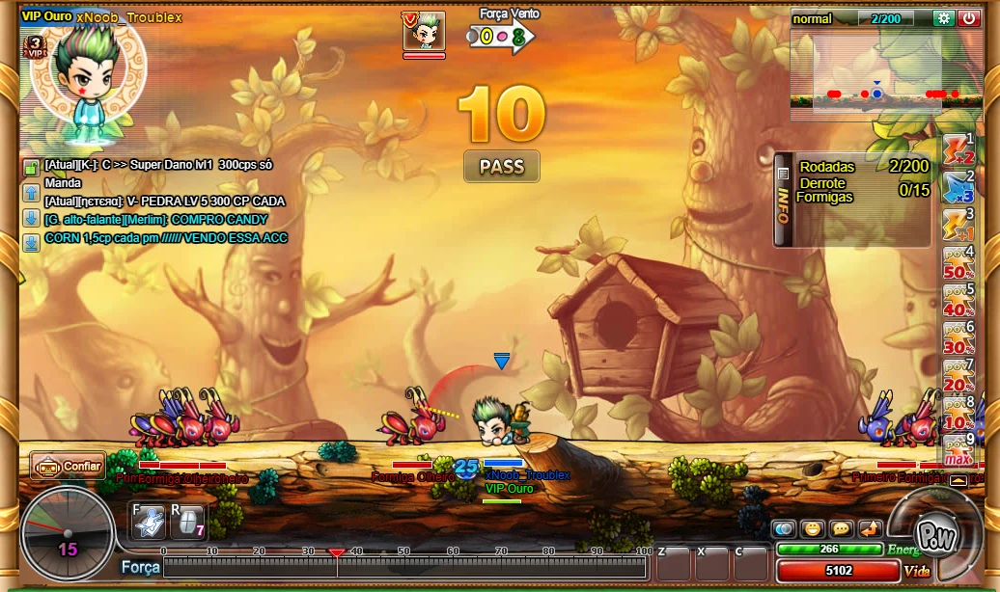
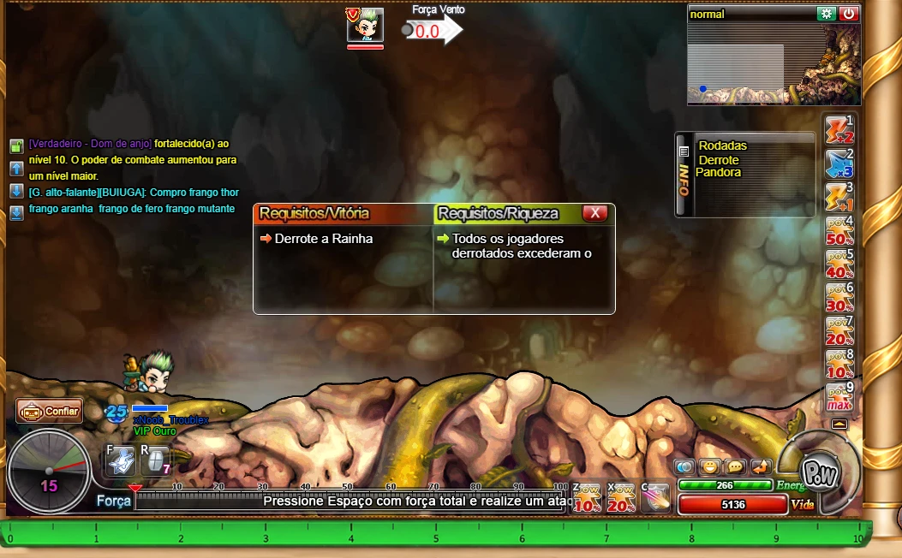
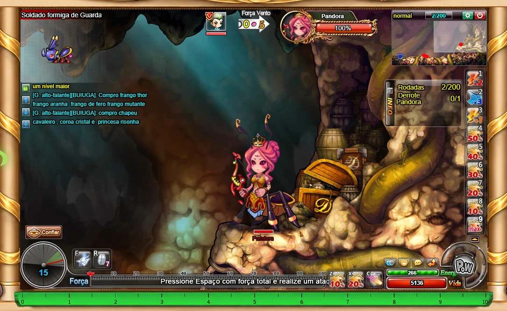
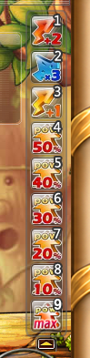

# Especificação do Bot — Fluxo de Entrada

Documento que descreve o fluxo de telas (estados) que o bot deve reconhecer e a ação a executar em cada uma.

> As imagens ficam na pasta `imagens/`, ao lado deste arquivo.

---

## Visão geral do fluxo

```
[Estado 1] Seleção de canal ──clicar "Canal 2"──▶ [Estado 3] Lobby principal
                                                       ▲
[Estado 2] Popup "aluno recomendado" (opcional) ──clicar "X"──┘

[Estado 3] Lobby principal ──clicar "Central"──▶ [Estado 4] Cais de expedição
[Estado 4] Cais de expedição ──clicar "Jogar"──▶ [Estado 5] Sala sem instância
[Estado 5] Sala ──clicar "Selecione a Instância"──▶ [Estado 6] Seleção de instância
[Estado 6] Seleção de instância ──"Formigueiro" → "Normal" → "ok"──▶ [Estado 7] Sala pronta
[Estado 7] Sala pronta ──clicar "Início"──▶ [Estado 8] Popup "Lembrete" (opcional) ──"OK"──▶ batalha
```

| Estado | Tela | Ação | Alvo do clique |
|---|---|---|---|
| 1 (inicial) | Seleção de canal | Clicar | Canal 2 |
| 2 (condicional) | Popup "aluno recomendado" | Clicar | Botão **X** (fechar) |
| 3 | Lobby principal (cidade) | Clicar | Prédio **Central** |
| 4 | Cais de expedição | Clicar | Botão **Jogar** |
| 5 | Sala sem instância | Clicar | **Selecione a Instância** |
| 6 | Seleção de instância | Clicar 3x | **Formigueiro**, **Normal**, **ok** |
| 7 | Sala pronta | Clicar | **Início** |
| 8 (condicional) | Popup "Lembrete" (lutar sozinho) | Clicar | **OK** — a batalha começa |

---

## Estado 1 — Seleção de canal (estado inicial)

**Como reconhecer:** tela de entrada com a cidade escurecida ao fundo e um painel central listando os canais (Canal 1 a Canal 4), cada um com indicador de lotação (GOOD / LOW).


**Ação:** clicar no **Canal 2**.


---

## Estado 2 — Popup "aluno recomendado" (condicional)

**Como reconhecer:** janela sobreposta ao lobby com o título **"aluno recomendado"**, três cartões de jogadores e o botão "Ir à escola".

> ⚠️ Esta tela **nem sempre aparece**. O bot só deve agir se ela for detectada; caso contrário, segue direto para o Estado 3.


**Ação:** clicar no botão **X** (canto superior direito do popup) para fechar.


---

## Estado 3 — Lobby principal

**Como reconhecer:** visão da cidade com os prédios nomeados (Laboratório, Ferreiro, Salão de Jogos, Escola, Leilão, Centro Comercial, Central etc.), sem popups abertos.


**Ação:** clicar no prédio **Central** (canto inferior direito).


---

## Estado 4 — Cais de expedição

**Como reconhecer:** tela com o título **"Cais de expedição"**, lista de salas à esquerda, informações do usuário à direita e os botões Equipe / Buscar / Jogar na parte inferior.


**Ação:** clicar no botão **Jogar**.


---

## Estado 5 — Sala sem instância

**Como reconhecer:** tela da sala ("Sala 1584", jogador como Dono, 3 vagas "Aguardando...")
com o quadro **"Selecione a Instância"** no centro.


Print da mesma tela na janela real do cliente: `imagens/16_tela_sala_janela_real.png`.

**Ação:** clicar no quadro **Selecione a Instância**.


---

## Estado 6 — Seleção de instância

**Como reconhecer:** janela **"Configuração da sala"** (título no topo). O botão Troque da
sala continua visível atrás dela, por isso o bot reconhece esta janela antes da sala pronta.


Print na janela real do cliente: `imagens/18_configuracao_sala_janela_real.png`.

**Ação:** clicar em sequência:

1. **Formigueiro**
   
2. Dificuldade **Normal**
   
3. **ok**
   

> Depois de escolher o Formigueiro, as dificuldades mudam de **Normal / Difícil / Avançado**
> para **Fácil / Normal**, e o Normal muda de lugar. O bot procura o botão de novo a cada clique.
>
> Os botões das imagens 11 e 12 estão com o brilho de mouse em cima; os templates em `img/`
> foram recortados do print real, sem o brilho.

---

## Estado 7 — Sala pronta

**Como reconhecer:** a mesma sala, já com a instância escolhida (o quadro "Selecione a
Instância" sumiu), com os botões Convide / Troque / Início.


**Ação:** clicar em **Início**. O botão é animado; o bot acha o **Troque** e clica 70 px à direita.

---

## Estado 8 — Popup "Lembrete" (condicional)

**Como reconhecer:** popup **"Lembrete"** avisando que a instância é difícil para jogar sozinho.

> ⚠️ Pode não aparecer. Se aparecer, confirma; se não, a batalha começa direto.


**Ação:** clicar em **OK**. A batalha começa.

---

## Estado 9 — Batalha (v1: força e skills)

**Como reconhecer:** rótulo **"Força"** ao lado da barra de força (canto inferior esquerdo).
Todas as outras posições do HUD são medidas a partir dele.



| O quê | Como o bot lê |
|---|---|
| Minha vez | botão **PASS** na tela |
| Eu | barra de vida **azul** |
| Inimigos | barras de vida **vermelhas** (formigas juntas viram um alvo só) |
| Distância | pixels na horizontal ÷ 100 (a régua verde 0–10 cobre a tela de ~1000 px) |
| Força do último tiro | marcador vermelho acima da barra |

**Ação na minha vez:**
1. Escolher o inimigo mais perto na horizontal.
2. Força = `FORCA_FIXA` (Formigueiro: **10**) ou, sem força fixa, a tabela de `ANGULO` pela distância.
3. Tocar a seta para o lado do alvo (vira o personagem).
4. Ler o ângulo pela agulha do relógio e apertar ↑/↓ até `ANGULO` (Formigueiro: **30**).
5. Apertar as teclas de `SKILLS`, em ordem.
6. Segurar **Espaço** e soltar quando a barra chegar na força.
7. Se não achar a mim ou os inimigos: com força fixa, atira alternando os lados;
   sem força fixa, clica em **PASS**.

**Formigueiro:** as formigas sempre vêm até o personagem, então ângulo 30 e força 10 nos dois
lados resolvem até todas morrerem. **Formiga colada** exatamente em cima do personagem (a barra
dela some atrás da minha): força **1**.

**Virar:** o bot só aperta a seta de virar se o personagem estiver olhando para o lado errado
(a agulha vermelha do relógio aponta para onde ele olha), porque a seta também o faz andar.

---

## Estado 10 — Batalha, estágio 2: Pandora (rainha formiga)

**Como reconhecer:** quadro de missão com **"Derrote Pandora"** (no estágio 1 é "Derrote Formigas").





**Ação em cada turno:**
1. Virar para a direita (a Pandora fica à direita).
2. Se o número do relógio já é **30**, não andar nem mexer no ângulo.
   Se não é, ajustar com ↑/↓; se o chão não deixar chegar em 30 (o número para de mudar),
   **andar para trás (←)** um pouco e tentar de novo. Chegou em 30: não se mexe mais.
3. Usar os itens **3 (+2)** e **9 (dano max)**. Sem energia, o jogo ignora o item.
4. Atirar com força **80**.

Itens da coluna da direita (teclas 1 a 9):



Tabelas (força por distância 1 a 20), copiadas da moldura do cliente:

| Âng. | 1 | 2 | 3 | 4 | 5 | 6 | 7 | 8 | 9 | 10 | 11 | 12 | 13 | 14 | 15 | 16 | 17 | 18 | 19 | 20 |
|---|---|---|---|---|---|---|---|---|---|---|---|---|---|---|---|---|---|---|---|---|
| 20 | 10 | 19 | 25 | 30 | 36 | 40 | 44 | 48 | 51 | 54 | 57 | 60 | 63 | 66 | 69 | 72 | 74 | 76 | 78 | 80 |
| 30 | 14 | 20 | 24 | 28 | 32 | 35 | 38 | 41 | 44 | 47 | 50 | 52 | 55 | 57 | 60 | 62 | 65 | 67 | 69 | 72 |
| 50 | 14 | 20 | 24 | 28 | 32 | 35 | 39 | 42 | 44 | 48 | 50 | 53 | 55 | 58 | 60 | 63 | 65 | 68 | 70 | 72 |
| 65 | 13 | 20 | 26 | 31 | 37 | 41 | 44 | 48 | 53 | 56 | 58 | 61 | 64 | 67 | 70 | 73 | 76 | 79 | 82 | 85 |

**Ainda não faz:** ler/ajustar o ângulo (deixe o ponteiro em `ANGULO`), compensar o vento
(cada 0.5 de vento muda o ângulo um pouco), corrigir altura e obstáculos, PoW, loot.

---

## Próximos estados

_A definir:_ ângulo e vento na batalha, fim da batalha e loot.
