# Especificação do Bot — Fluxo de Entrada

Documento que descreve o fluxo de telas (estados) que o bot deve reconhecer e a ação a executar em cada uma.

> As imagens ficam na pasta `imagens/`, ao lado deste arquivo.

---

## Visão geral do fluxo

```
[Estado 1] Seleção de canal ──clicar "Canal 2"──▶ [Estado 3] Lobby principal
                                                       ▲
[Estado 2] Popup "aluno recomendado" (opcional) ──clicar "X"──┘

[Estado 3] Lobby principal ──clicar "Central"──▶ [Estado 4] Cais de expedição
[Estado 4] Cais de expedição ──clicar "Jogar"──▶ [Estado 5] Sala sem instância
[Estado 5] Sala ──clicar "Selecione a Instância"──▶ [Estado 6] Seleção de instância
[Estado 6] Seleção de instância ──"Formigueiro" → "Normal" → "ok"──▶ [Estado 7] Sala pronta
[Estado 7] Sala pronta ──clicar "Início"──▶ [Estado 8] Popup "Lembrete" (opcional) ──"OK"──▶ batalha
```

| Estado | Tela | Ação | Alvo do clique |
|---|---|---|---|
| 1 (inicial) | Seleção de canal | Clicar | Canal 2 |
| 2 (condicional) | Popup "aluno recomendado" | Clicar | Botão **X** (fechar) |
| 3 | Lobby principal (cidade) | Clicar | Prédio **Central** |
| 4 | Cais de expedição | Clicar | Botão **Jogar** |
| 5 | Sala sem instância | Clicar | **Selecione a Instância** |
| 6 | Seleção de instância | Clicar 3x | **Formigueiro**, **Normal**, **ok** |
| 7 | Sala pronta | Clicar | **Início** |
| 8 (condicional) | Popup "Lembrete" (lutar sozinho) | Clicar | **OK** — a batalha começa |

---

## Estado 1 — Seleção de canal (estado inicial)

**Como reconhecer:** tela de entrada com a cidade escurecida ao fundo e um painel central listando os canais (Canal 1 a Canal 4), cada um com indicador de lotação (GOOD / LOW).

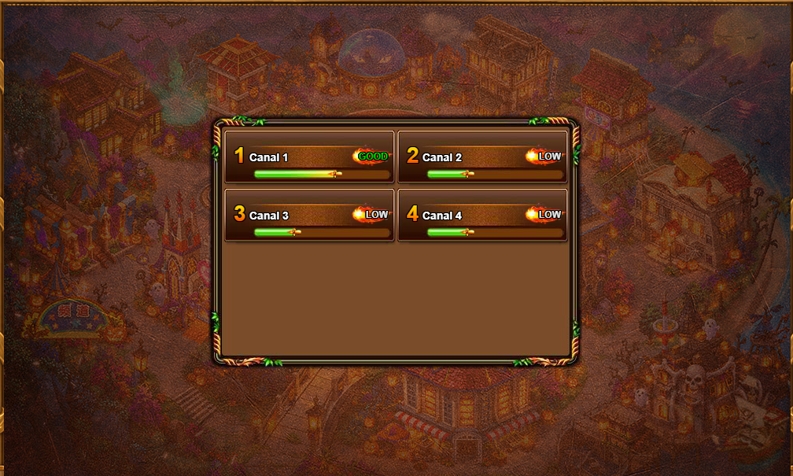

**Ação:** clicar no **Canal 2**.

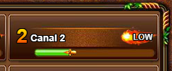

---

## Estado 2 — Popup "aluno recomendado" (condicional)

**Como reconhecer:** janela sobreposta ao lobby com o título **"aluno recomendado"**, três cartões de jogadores e o botão "Ir à escola".

> ⚠️ Esta tela **nem sempre aparece**. O bot só deve agir se ela for detectada; caso contrário, segue direto para o Estado 3.

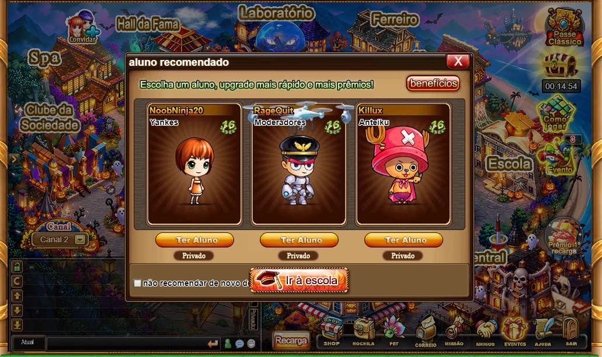

**Ação:** clicar no botão **X** (canto superior direito do popup) para fechar.

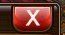

---

## Estado 3 — Lobby principal

**Como reconhecer:** visão da cidade com os prédios nomeados (Laboratório, Ferreiro, Salão de Jogos, Escola, Leilão, Centro Comercial, Central etc.), sem popups abertos.

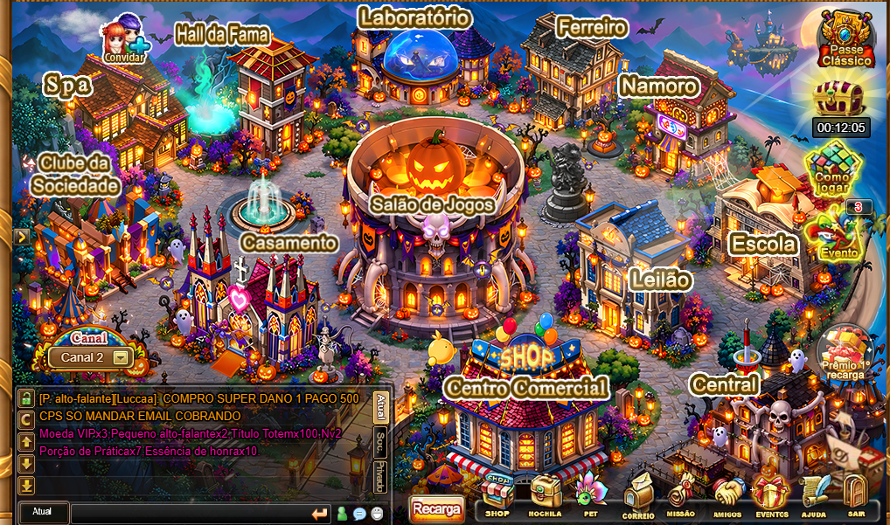

**Ação:** clicar no prédio **Central** (canto inferior direito).

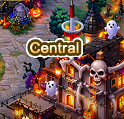

---

## Estado 4 — Cais de expedição

**Como reconhecer:** tela com o título **"Cais de expedição"**, lista de salas à esquerda, informações do usuário à direita e os botões Equipe / Buscar / Jogar na parte inferior.

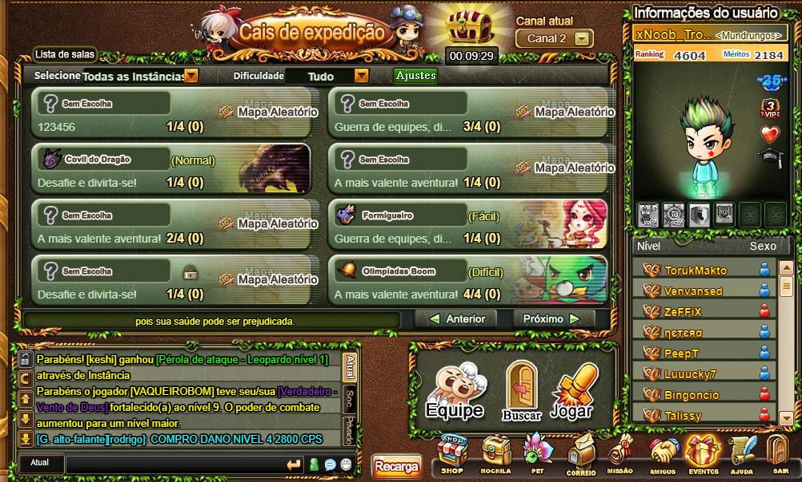

**Ação:** clicar no botão **Jogar**.

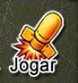

---

## Estado 5 — Sala sem instância

**Como reconhecer:** tela da sala ("Sala 1584", jogador como Dono, 3 vagas "Aguardando...")
com o quadro **"Selecione a Instância"** no centro.

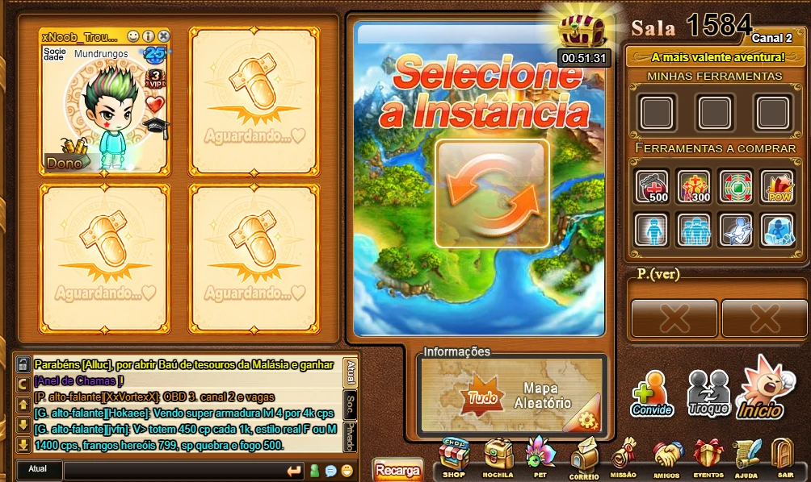

Print da mesma tela na janela real do cliente: `imagens/16_tela_sala_janela_real.png`.

**Ação:** clicar no quadro **Selecione a Instância**.

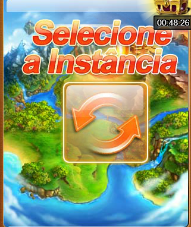

---

## Estado 6 — Seleção de instância

**Como reconhecer:** janela **"Configuração da sala"** (título no topo). O botão Troque da
sala continua visível atrás dela, por isso o bot reconhece esta janela antes da sala pronta.

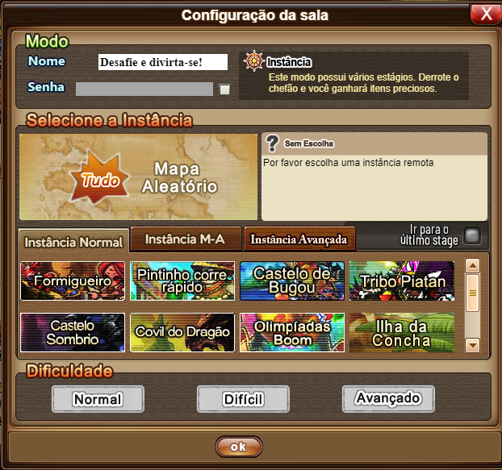

Print na janela real do cliente: `imagens/18_configuracao_sala_janela_real.png`.

**Ação:** clicar em sequência:

1. **Formigueiro**
   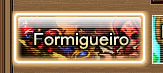
2. Dificuldade **Normal**
   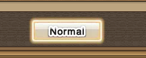
3. **ok**
   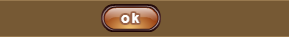

> Depois de escolher o Formigueiro, as dificuldades mudam de **Normal / Difícil / Avançado**
> para **Fácil / Normal**, e o Normal muda de lugar. O bot procura o botão de novo a cada clique.
>
> Os botões das imagens 11 e 12 estão com o brilho de mouse em cima; os templates em `img/`
> foram recortados do print real, sem o brilho.

---

## Estado 7 — Sala pronta

**Como reconhecer:** a mesma sala, já com a instância escolhida (o quadro "Selecione a
Instância" sumiu), com os botões Convide / Troque / Início.

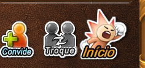

**Ação:** clicar em **Início**. O botão é animado; o bot acha o **Troque** e clica 70 px à direita.

---

## Estado 8 — Popup "Lembrete" (condicional)

**Como reconhecer:** popup **"Lembrete"** avisando que a instância é difícil para jogar sozinho.

> ⚠️ Pode não aparecer. Se aparecer, confirma; se não, a batalha começa direto.

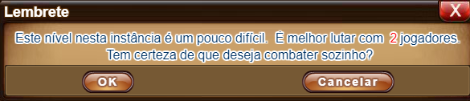

**Ação:** clicar em **OK**. A batalha começa.

---

## Próximos estados

_A definir:_ batalha (turno, mira, tiro) e loot.
